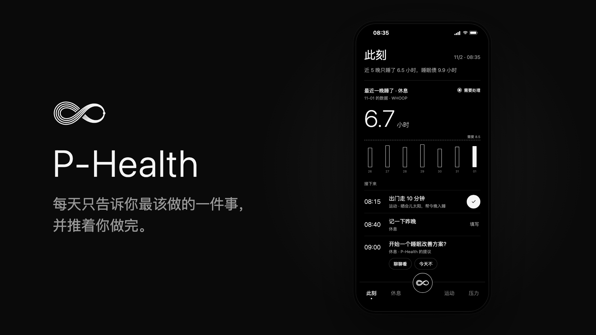
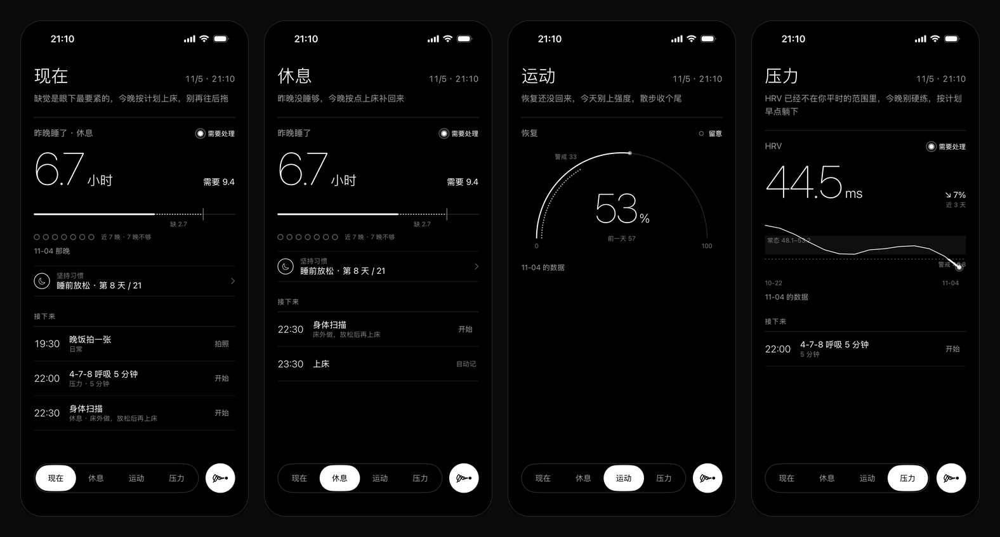
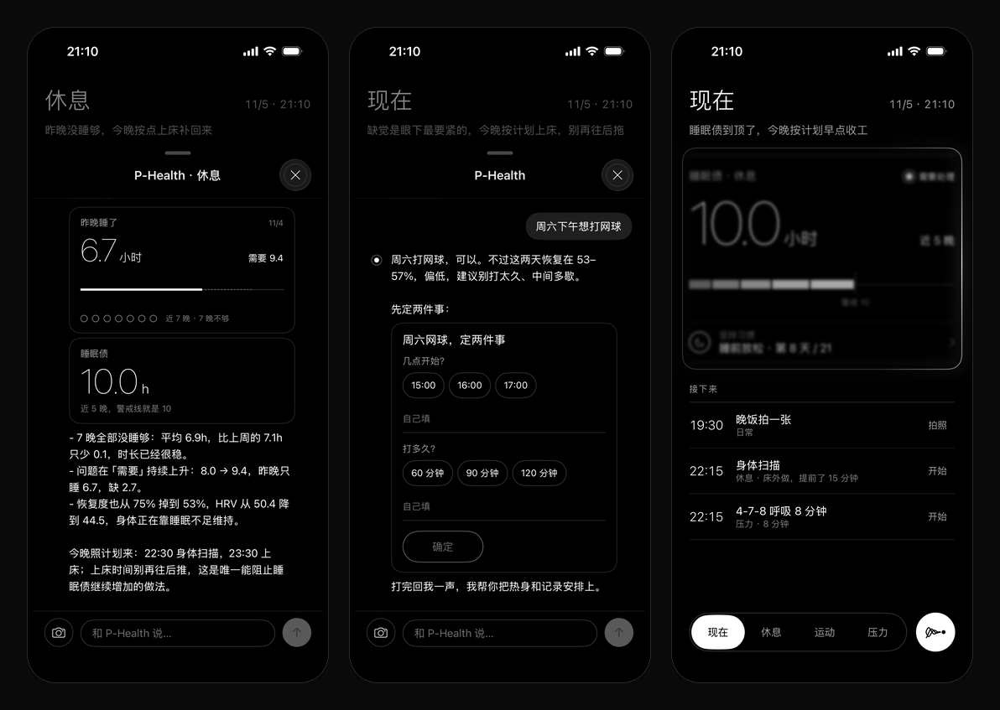
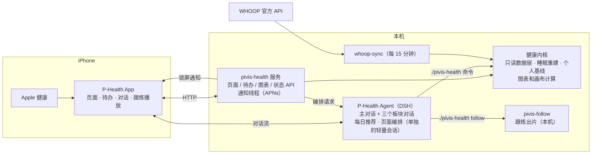

# P-Health · pivis-health

**一个会盯着你的健康数据、告诉你今天该做什么、并推着你去做的私人健康管家。**

[](docs/media/phealth-promo.mp4)

> ▶ 点上图看介绍视频（[docs/media/phealth-promo.mp4](docs/media/phealth-promo.mp4)，112 秒）。画面里的界面是对照 App 重画的，数字是演示数据；跟练画面是示意人物，不是真人素材。

P-Health 由四部分组成：

- **iOS App**（SwiftUI，黑白细线风格，在 [`ios/`](ios/)）：四个板块页、生成式待办、和 P-Health 对话、跟练视频播放、锁屏通知、主屏小组件。
- **pivis-health**（Python，在仓库根目录）：健康内核和服务端。负责读数据、做确定性计算，提供页面、待办、图表、通知和同步接口。
- **P-Health Agent**（跑在 DSH 上）：页面上写什么、主卡画什么图、待办怎么排、对话怎么回，都由它根据真实数据决定。
- **跟练出片工具**（本机的 pivis-follow，不在本仓库）：把博主的动作示范视频剪成能直接跟着练的片子。服务端通过 `./pivis-health follow …` 调用它。

App 只负责画出来，内核只负责把数算对；中间所有"说什么、做什么"都交给 Agent。

## 安装（DeepSeek Harness 插件）

P-Health 跑在**你自己的 Mac** 上，数据只在你的电脑里。三步：

1. **在 DeepSeek Harness 里装插件**：新开一个对话，发一句「帮我安装 P-Health：先运行 `dsh plugin --profile phealth add github:PivisYYY/pivis-health`，再运行 `~/.dsh/profiles/phealth/node_modules/dsh-plugin-phealth/bin/phealth setup`，最后把出现的二维码给我」。或者在 DSH 的「插件 › 发现 › 添加索引源」里填 `https://raw.githubusercontent.com/PivisYYY/pivis-health/main/dsh/market-index.json`，装「P-Health 私人健康管家」，再跟「P-Health」助手说「开始安装」。
2. **装 App**：iPhone 上打开 TestFlight 公开链接（*TestFlight 外部测试审核通过后放在这里*）。
3. **扫码配对**：打开 App 点「扫码配对」，扫电脑上的二维码。手机和电脑在同一个 Wi-Fi；出门在外用 Tailscale。

装了什么、怎么卸载、出问题怎么办，见 [INSTALL.md](INSTALL.md)。没有电脑也可以在 App 里点「先看看演示」。



> 截图里的数据全部是编出来的演示数据（[`examples/make_demo.py`](examples/make_demo.py) 生成），不来自任何真人。

## 三条原则

1. **监测 → 建议 → 推动执行**。不只是展示指标，要走完一个闭环：找出眼下最该注意的一件事，给出今天能做的动作，到点提醒，做完记下来，再看有没有效果。
2. **Agent 原生**。页面结构固定，内容由 P-Health 生成：主卡指标和画法、待办、习惯项目、对话里的卡片都是。
3. **越用越懂你**。你说一次"睡眠图看 14 晚""步数目标 1 万""提前 15 分钟提醒"，它就记成偏好，之后页面和对话都照做；你纠正过的专业判断，它不会再犯。

底线：**所有数字都来自内核计算，Agent 不自己编数**；**不做诊断**；**数据缺了就直说缺了**。常态范围按你自己近 30 天的数据算，不是医学标准。

## 功能一览

| 功能 | 一句话 |
|---|---|
| [四个板块](#四个板块每页只讲一件事) | 现在 / 休息 / 运动 / 压力，每页一张主卡（最有问题的那个数和它的现状）、最多 3 件待办，不写解释 |
| [主卡和画布](#主卡和对话里的图由-p-health-选) | 7 种主卡画法 + 55 个画布零件，P-Health 自己拼图，数字由内核现算 |
| [生成式待办和习惯](#生成式待办和习惯) | 13 种待办形式，长期项目每天自动出待办，每天三次主动推荐，周日复盘 |
| [跟练视频](#跟练视频) | 发一个博主视频，P-Health 先看懂、给方案，你确认后剪成带讲解的跟练片 |
| [洞察](#洞察) | 每 3 天看一次：督促管不管用、闭环断在哪、几种数据放一起的规律、你没注意到的事；有值得说的才找你聊 |
| [通知和闹钟](#通知和闹钟) | 回复、新问题、待办提前 / 到点 / 过点都推到锁屏；待办一定有时间，没定的先拟一个请你确认；推送失败重试、有兜底 |
| [专业知识](#专业而且越用越专业) | 管家 + 医生 + 教练 + 康复师 + 营养师五个身份；每轮先看服务器算好的全盘简报，给判断、给依据、给具体处方 |
| [康复和营养](#康复师和营养师) | 伤病档案、0–10 疼痛打卡和红黄绿灯决定进阶还是退一步；按体重、活动和目标算热量和蛋白质，饭的照片按手掌份量记 |
| [反馈和每周复盘](#反馈和每周复盘) | 每条回复可以点赞点踩；每周一复盘 P-Health 自己的对话，你逐条同意后改进 |
| [对话](#和-p-health-对话) | 回复里带卡片、拍照直接发、显示它正在做什么 |
| [开屏](#开屏一句反直觉的健康观) | 每次打开一条"反直觉、但是对的"健康观，带出处 |
| [数据](#数据) | Apple 健康 + WHOOP 官方 API；先分清原因，只有要你动手时才提示 |

## 功能

### 四个板块，每页只讲一件事

「现在 / 休息 / 运动 / 压力」，每页从上到下依次是：

- **主卡**：眼下最有问题的那个数和它的现状，不配解释；档位（需处理 / 留意 / 平稳）只用一个小圆点表示，档位不同，动效强弱不同。
- **坚持习惯**：正在进行的长期项目，一行一个，比如"睡前放松 · 8/21"。点开进这个习惯的对话，顶上是习惯卡：本周 7 天做到没有，以及每次练的是哪个视频。
- **接下来**：最多 3 件最急的待办，其余收在「另有 N 件」里。每件收起时只显示时间和标题，点开才有备注和要填的东西。
- **一天到早上 6 点才翻页**：熬过零点，页面上还是今晚的事；凌晨 0–6 点的待办（比如 00:30 上床）算前一天的。

### 主卡和对话里的图由 P-Health 选

**主卡的 7 种画法**：

| 画法 | 适合 | 看什么 |
|---|---|---|
| 折线 trend | HRV、呼吸、睡眠时长 | 走势、个人常态带、警戒线 |
| 半圆仪表 gauge | 恢复 | 分数落在哪一档 |
| 睡了 vs 需要 need | 睡眠 | 昨晚差多少，近 7 晚有几晚没睡够 |
| 叠起来 stack | 睡眠债 | 每晚欠的累计到多少 |
| 区间刻度 range | 静息心率 | 今天在自己常态的哪个位置 |
| 进度 progress | 步数 | 按此刻该走到哪 |
| 路线 route | 体重 | 朝目标的计划路线和实际 |

**开放画布**：一张图讲不清时，P-Health 用零件拼一张卡。零件共 55 个，分五组：基础（大数字、字段、一排点、竖柱……）、趋势（走势、散点、对比……）、进度（进度条、圆环、倒计时……）、时间（作息条、睡眠阶梯、24 小时钟、日历、提醒到动手、每天一点……）、占比（饼图、堆叠条、方格、心率区间、雷达、两组对比）。P-Health 只选零件、写绑定，数字由内核现算；样式由 App 统一，它不写颜色和字号。发之前服务器会校验，不合规范就退回让它改。

你在对话里说"换一种看法"，它会先在对话里给你看页面同款的预览，你确认后再改，页面一两分钟后自动换上。

### 生成式待办和习惯

- **13 种待办形式**：打勾、单选、数值、多字段日记、计数、计时、练习视频、拍照、打分、提议、追问、设备自动完成、确认 + 时间。点下去 1 秒内有反应；断网先记在手机上，连上后自动补发，重复提交只算一次。
- **长期项目**（CBT-I 6 周、膝关节康复、减重路线……）：每天自动生成当天的待办，还能只在一周的某几天出现。改了模板，当天还没开始的那张跟着变。
- **主动推荐**：每天 08:00、13:00、18:00 各一次，P-Health 推荐 1–2 件当下最合适的事，写成待办卡。早上那次顺带看昨天做得怎么样，连着漏两次的会问原因。
- **周复盘**：周日早上给每个进行中的项目出一张"本周复盘"提议卡，执行率由内核算，调不调计划由你选。
- **首周了解你**：头 7 天每天问 2–4 个问题（目标、作息、睡眠……），问完给你一张"我对你的理解"让你纠正。
- **"算了"只管今天**：今天不想做就不再提，不叠加补偿任务，第二天照常；你说"以后都不要"才改计划。
- 上床这类能自动识别的，设备记到就自动勾上。

### 跟练视频

练习类的习惯（拉伸、力量、康复、放松）都是「项目 + 一个跟练视频」，视频只认下面这条流程出的片。

**怎么来的**

1. 你在对话里分享一个小红书或 B 站的动作示范视频。
2. P-Health **先看懂，不急着剪**：一共几个动作、各在原片哪一段、博主口头讲了什么、有没有清楚的单人全身示范。只有讲解没有示范、多人拼图、治疗师扶着做的被动动作、镜头一直在切的电视节目，它会直接说不建议剪，并说明原因。
3. 适合剪的，它发一张方案卡：剪哪几个动作（和原片一个不少，要删的说明为什么）、每个用原片哪一段讲解和示范、每侧几秒、做几轮、成片大概几分钟。
4. 你点「就这样剪」才出片；出好了再放进计划。

**成片长什么样**

- 每个动作前先放**博主的讲解段**：原画原声，听博主讲哪块肌肉、怎么发力、什么感觉。
- 然后是**跟练循环**：挑一段只有一个人、全身入镜、真在做的示范，保持博主原速，按你定的秒数循环，接缝看不出来；去掉原片字幕，配上每秒报数和教练提示，加背景音乐。可以做多轮，第二轮起不再放讲解。
- 画面上**署博主的名字**。
- **验收不过不交付**：每组时长、原速、报数、配音质量、响度、字幕残留、全身入镜、循环接缝、署名、讲解段、单人示范，逐项检查。

**怎么用**

- 点练习卡直接全屏播放，锁屏也能听到声音。
- 视频第一次播放时下到手机上，之后直接放本地文件；今天要练的视频会在 Wi-Fi 下提前下好，出门在外也能放。
- 想删掉某个动作重新出片，在对话里说一声就行。
- 视频只给你自己用，不上传到任何公开网站。

### 洞察

洞察是 P-Health 对"你这个人"的深度判断，不是数据看板。它看四类事：

- **督促管不管用**：哪个提醒总是响了也不动、你一般几点才真正开始、什么情况下容易落下（比如前一晚没睡够，第二天的训练常常不做）。
- **闭环断在哪**：每个在管的问题走到了哪一环（发现 → 建议 → 接受 → 做到 → 有效）。断在 P-Health 自己那一环的，比如发现了却没给建议，也照实说。小实验到期了，就给结果。
- **几种数据放在一起的规律**：只看事先定好的几组"做了什么 × 结果怎样"，不乱撞。比如做了睡前拉伸的晚上睡得怎样、外宿后 3 天恢复怎样、晚饭晚的第二天 HRV 怎样；也看习惯坚持了 3 周以上、指标却不再变的平台期。
- **你没注意到的事**：状态最好的那些天前面都有什么；对话里反复提到、却没有计划在管的部位或困扰。

**怎么出现**：服务器每 3 天扫一次，有够格的才找你，没有就不打扰。App 外推一条通知，App 里弹横幅，主对话输入框上方浮一条"这几天看出 N 件事，要聊聊吗？"。点开后 P-Health 发一段话：最多 3 点，每点一句结论加一两句说明，需要时配一张小图（提醒到动手、两组对比、每天一点等），最后一张选项卡让你挑先动哪个。

**规矩**：

- 每一点要同时满足五条才说：能落到一个行动上、你还不知道、证据够、跟你在意的事有关、4 周内没说过。
- 数字只来自服务器计算，样本不够不出；几种数据放一起的规律要先攒够 4 周数据，两组各 5 次以上，差别还要大过你自己平时的波动。只说"常一起出现"，不说"导致"。
- 稿子由 P-Health 写，服务器逐条校验：数字必须在候选里、不能说因果、不做诊断、不说教，不过就退回重写。
- 只有"提醒挪个时间、换个形式"这种小调整可以先改再告诉你，回一句就改回；其余改动都要你确认。
- 定位、蓝牙这类场景数据只在家里的服务器上算，发给模型的只有"在家 / 外出 / 外宿"这样的标签。
- 推送默认关闭：先试算几期、看过结果再打开。

**越用越准**：

- 你点了选项、确认了改计划，或者先改后说的提醒没改回，都算采纳，下一期必出这件事的结果。
- 你说"不对"的那条 4 周不再说；同一类 4 周里被否两次，这一类暂停 4 周；一直没理的那类往后排。
- 连续两次扫描都成立、你也看过的规律，会写进 P-Health 的记忆，之后排计划照它来；被你否掉的自动撤掉。
- 排提醒前，P-Health 先看每个重复提醒以前做得怎样：你一般晚一小时才做的，就放到你真正做的时间；连续 3 次没动的，先问你还要不要。

### 通知和闹钟

- 服务器统一推送：P-Health 每回完一轮话、新问你一个问题、待办提前 N 分钟（默认 10，可以跟它说"提前 15 分钟提醒"）、到点、过点 15 分钟还没做，各推一次。
- 待办上写的是真正要做的时刻，提前量只由服务器给。服务器每 20 秒把有时间的待办对一遍，不调用模型。
- **待办一定有时间**：P-Health 加卡没写时间，服务器按今晚的时间线（从上床时间倒推）先拟一个，推一条「先给 X 排了 23:05，行吗？」，通知上直接点「好」或「换个时间」；不回就按这个时间提醒。
- **怎么提醒由 P-Health 定，推送由服务器保证**：每张卡可以单独改提前量、另加钟点、过点催不催、不提醒；也能单独排一条到点提醒。推送失败自动重试，服务重启过点 15 分钟内补发，另有每分钟一次的独立兜底任务；每小时自查有没有漏推。哪张卡有提醒对你是无感的，卡上不标。
- 计时类（午睡、泡脚）：点「开始」就在手机上定一个系统闹钟，静音也响。服务器在同一时刻再推一条带声音的"时间到了"兜底。
- 没看的回复，在对应入口上显示小红点。
- P-Health 自己不建定时任务、不自己推送：要到点提醒的事一律写成带时间的待办卡，你在 App 里看得到、点得了。

### 专业，而且越用越专业

- **三个身份**：管家（了解你、安排每天的事、按时跟进）、医生（给专业判断、讲清为什么、按红旗分诊、该看医生就直说；不下疾病诊断名、不开药，但不拿「不诊断」回避判断）、教练（给具体规则和训练量、要求照做、只在周复盘时按数据调计划）。
- **全盘简报**：服务器把你此刻的全部数据算成一页——今天的状态和你自己的常态比、近 7 晚作息、训练、体重、习惯完成率、今天还没做的事、从上床时间倒推的今晚时间线、伤病限制、目标、交叉信号（比如「恢复红区 + 呼吸频率偏高 → 今天按恢复日过」）、数据缺口和档案还缺什么。它写在工作区的指令文件里，DSH 每轮自动带给 P-Health，数据变了才更新。
- **回答有固定结构**：判断（属于哪一类、最可能的原因）→ 依据（你自己的 2–3 个数 + 证据等级）→ 处方（具体时刻、组数、量）→ 怎么验证 → 什么情况去医院。睡眠问题先分型：失眠、睡眠机会不足、作息偏晚、作息不规律、夜醒早醒，方案各不相同。
- **计划冲突检查**：P-Health 加卡、改卡时，服务器对照今晚的上床时间查明显冲突（洗澡离上床不到 1 小时、剧烈运动太晚、CBT-I 期间午睡太长），有就退回让它改。
- **目标**：你说出的目标（减到多少公斤、每晚睡够几小时）记成正式目标，简报和复盘按它算进度。
- **专业资料**：睡眠（CBT-I）、训练（含膝关节和半月板的保守训练）、减重饮食（含 GLP-1 / GIP 类药物期间）、压力恢复、习惯养成、身体不适分诊，各有一份。内容有原理、能直接照着用的决策表、证据等级（A / B / C），并附指南和文献（[`agent/skills/*/references/`](agent/skills)）。
- **回答要具体**：比如从上床时间往回推出几点停咖啡、几点洗完澡；疼到几分该退一级。还要说出依据，证据弱就直说。
- **你纠正一次，它就不再犯**：纠正过的专业要点记成「正确做法」，每个会话都看得到；同一件事被纠正第二次，它会提出写进专业资料。
- 每一块都有考题，放在封版测试里跑。

### 康复师和营养师

- **康复师**：哪里疼先过红旗（夜里不动也疼、发烧、外伤后不能负重、会阴发麻或大小便异常这类直接让你去医院），再问清部位、怎么伤的、什么加重什么缓解，建一份伤病档案。按「保护 → 恢复负荷 → 力量 → 回归运动 → 维持」分阶段给动作、组数、频率和进阶标准，动作都做成跟练视频。
- **疼痛打卡**：每天一张卡记休息时、练的时候和第二天早上疼几分（0–10），提交后服务器直接记下，不用等 P-Health。按疼痛监控模型亮灯：活动时 ≤ 2 分绿灯，3–5 分且第二天早上回到平时黄灯，超过 5 分或第二天更疼更僵红灯。连续一周绿灯才进阶，近 3 天有红灯就退一步，由内核算，P-Health 照着说。
- **营养师**：按身高、年龄、性别、体重、近 7 天步数和训练算基础代谢和每天消耗，有减重目标就留 15–25% 缺口（有伤在养最多 15%），蛋白质按体重给范围，再换成每顿饭几掌心蛋白、几捧主食、几拳蔬菜、几拇指油。
- **饭的照片**：P-Health 只估手掌份量（中式菜的油和酱算进拇指），服务器换成蛋白质和热量的范围；回复只说范围，讲这一餐做得好的一点和最该改的一点，并对照今天的累计和最后一餐离上床多久。
- 全盘简报里有「康复」和「营养」两段，P-Health 每轮都看得到。

### 反馈和每周复盘

- **一键反馈**：P-Health 每条回复下面有 👍 / 👎。点踩可以选原因（不专业、没结合我的数据、太空泛、说错了、没照做、太长），也可以写一句「应该是……」；写了的会马上转给 P-Health，让它当场改正并记成纠正。
- **每周复盘**：每周一早上，服务器复盘 P-Health 这一周的对话——算好账（多少轮、👍 / 👎 各多少、按原因分、用专业资料的比例、回复速度、和上周比），挑出点踩的和有代表性的对话，写出最该改的 1–3 个问题：例子、错在哪、正确该怎么答、该改哪一层。形式和洞察一样：主对话入口浮出一条，点「看看」后 P-Health 原样发给你，每一条你点「同意」或「不对」。
- **同意之后**：只是你个人偏好的，P-Health 当场记进记忆；规则、专业资料、数据、工具这类进待改清单，由开发改，改完先跑考题再上线。每个点踩的对话都会变成一道考题，存在本机的考题库里。

### 和 P-Health 对话



- 主对话加上休息、运动、压力三个板块对话，共用同一份记忆和工具；在哪个板块点开，就带着那个板块的上下文。
- 回复里可以带卡片：提问、方案确认、改动回执、页面同款的图、画布小卡、音视频。卡片发出前先过一遍格式检查。
- 回复是一句一句流出来的，过程中会显示它正在做什么，比如"看今天的待办""记下你的偏好"。
- 输入框旁有拍照按钮，拍完直接发给它。饭、试纸这类需要拍照记录的待办，点"拍照"也是拍完直接进对话，它看图后记到那条待办上。
- 待办卡和习惯行上都有 P-Health 的小图标：想改时间、今天不做、多说一句，点它带着这张卡进对话说。
- 它也能被拉进 DS Bot 团队群，和别的 Bot 一起讨论；群里定下的事当场落到计划里，App 这边接着跟进。

### 改动实时可见

P-Health 改页面或待办时，App 只框住正在变的那一块（上图右）：一道白光沿边框走，框里的内容变朦胧。改好后新内容自动换上，不用手动刷新；下拉也可以刷新。P-Health 在忙用图标和动效表示（中间的图标在动、对话里头像在动加一个小工具图标），不写「正在处理」这类字。

### 开屏：一句反直觉的健康观

每次打开 App 先看一句"反直觉、但是对的"健康观，比如"没睡好，第二天反而别补觉"。点开看机制、怎么做和出处；不点 5 秒后自己进 App。共 100 条，和你正在做的项目相关的更常出现，最近看过的不重复。

### 小组件和安装

- 主屏小组件：此刻主卡、今天还没做的待办（打勾类可以直接在小组件上勾）、上床时间、近 7 晚睡眠。
- 安装：TestFlight；或者开发版安装页（[`install/`](install/)，ipa 不进仓库）。开发版打开时会检查有没有新版本，有就提示更新。

### 数据

- **Apple 健康**：App 上报睡眠、步数、活动能量等，同一台手机重装 App 也只算一次。
- **WHOOP**：通过官方 API 每 15 分钟同步一次（夜里也拉），提供恢复、HRV、睡眠阶段、"需要睡多久"、静息心率、呼吸频率和训练；有新的恢复 / 睡眠 / 训练就马上重排页面。恢复、HRV、静息心率、呼吸频率算到醒来那天。
- **场景事件**：手机上报的定位、蓝牙、摘手环等原始事件，服务器幂等存下，按顺序交给 P-Health 判断要不要行动；开车时不即时打扰。
- **数据断了就如实说**："HRV 只到 10-31"。不拿旧数冒充新数，也不把缺数据当成正常或异常。WHOOP 断了的晚上，睡眠退回 Apple 健康的时长。
- **先分清原因，只有要你动手时才提示**：WHOOP 登录真的失效（在手机上就能重新登录），或者 App 在前台确实读不到 Apple 健康（权限关了），才在页面上写一句该做什么。服务器这边的问题、WHOOP 接口慢在重试、手机只是没打开 App，都不打扰你，P-Health 也不会说「没连上」；服务器每小时自查一次，有问题当 bug 记下来。
- 下拉刷新不再当场等 WHOOP：马上告诉你两边数据新不新，需要时后台补拉。Apple 健康有新数据时系统会把 App 叫醒上传，不用每次打开。

## 架构



- App 轮询 `/api/v3/status`：数据、页面或待办一变就自动刷新；哪一块正在被改，就框住哪一块。所有接口都要 App 的设备密钥，本机直连除外。
- 页面编排时，内核把"证据"（各项数值、能画的图、项目和待办）交给 Agent；Agent 回一份页面 JSON，服务器校验后才发布，校验不过就退回让它改。
- 偏好保存在 `pref.*` 记忆里，页面编排和对话共用同一份；你确认过的页面样子，发布前由代码核对。
- 你纠正过的专业要点（`correction.*`）、了解到的你（`profile.*` / `learn.*`）会渲染进 Agent 的规则文件，所有会话都看得到。
- 跟练成片只经自己的服务器（`/media/follow/…`）给 App，不外传。

更多见 [docs/ARCHITECTURE.md](docs/ARCHITECTURE.md)。

## 快速使用

```sh
python3 -m pivis_health.cli doctor             # 自检：库是否可读、各数据源最新到哪天
python3 -m pivis_health.cli viz                # 每项指标现在能不能画、在常态还是过了警戒线
python3 -m pivis_health.cli parts              # 画布零件说明书（--name <零件> 看全文）
python3 -m pivis_health.cli todo-forms         # 13 种待办形式和模板
python3 -m pivis_health.cli facts              # 页面编排用的证据
python3 -m pivis_health.cli page-v3 now        # 某个板块页的完整内容（now / sleep / sport / stress）
python3 -m pivis_health.cli todo-list          # 今天的待办
python3 -m pivis_health.cli whoop-status       # WHOOP 快照是否新鲜（不联网）
python3 -m pivis_health.cli insight-cycle --dry-run   # 洞察试算：这期能说什么（不推送）
python3 -m pivis_health.cli remind-stats       # 每个重复提醒以前做得怎样
python3 -m pivis_health.cli brief              # 全盘简报（P-Health 每轮看到的那一页）
python3 -m pivis_health.cli review-cycle --dry-run --force   # 对话复盘试算（不存、不推）
python3 -m pivis_health.cli serve              # 启动服务（默认 127.0.0.1:8943）
```

- 运行只需系统自带 Python 3.9+（插件装的环境用 DeepSeek Harness 自带的 Python 3.12），不依赖第三方库；读 DSH 对话记录要么有 `zstandard`，要么用 DeepSeek Harness 自带的 Node 解压。跑测试要装 pytest：`python3 -m venv .venv && .venv/bin/pip install pytest && .venv/bin/python -m pytest`。
- 本机路径、地址和凭据都写在 `config.local.json`，这个文件不进仓库。
- 想看演示环境：`python3 examples/make_demo.py <目录> .`，会生成一整套合成数据和配置。
- 跟练出片要本机装好 pivis-follow（不在本仓库），并在配置里打开 `follow_enabled`。

接入 Agent 的方式见 [docs/DSH-INTEGRATION.md](docs/DSH-INTEGRATION.md)，Agent 的规则见 [agent/AGENTS-v3.md](agent/AGENTS-v3.md)，技能见 [agent/skills/](agent/skills)。

## 目录

```text
pivis-health/
├── pivis_health/          # 内核与服务
│   ├── readonly.py        #   只读数据层（同一样本跨重装只算一次）
│   ├── sleep.py           #   睡眠重建（双计 / 平行轨防线）
│   ├── baselines.py       #   个人基线
│   ├── whoop.py / whoop_sync.py       # WHOOP 快照解析 / 官方 API 同步
│   ├── viz.py             #   主卡图表计算（7 种画法）
│   ├── canvas.py / canvas_parts.py    # 开放画布：零件校验和现算（55 个零件）
│   ├── todos.py           #   生成式待办与习惯项目
│   ├── coach.py           #   项目执行率、一周睡眠、周复盘的统计
│   ├── insight.py / insight_cross.py  # 洞察：找候选、写稿校验、反馈学习 / 几种数据放一起的规律
│   ├── journal.py         #   推送、P-Health 行动、待办变化的长期记录（只追加）
│   ├── scene.py           #   场景标签（在家 / 外出 / 外宿），坐标不出本机
│   ├── brief.py / goals.py            # 全盘简报（交叉信号、今晚时间线、数据缺口）/ 目标
│   ├── plan_lint.py       #   计划冲突检查（洗澡、运动、CBT-I 上床和午睡）
│   ├── feedback.py / review.py        # 回复的 👍 / 👎 / 每周对话复盘
│   ├── v3.py              #   页面证据、编排、校验，同步状态
│   ├── cards.py           #   对话卡片的格式检查
│   ├── notify.py / apns.py            # 通知线程和 APNs
│   ├── follow.py          #   跟练出片工具的桥（./pivis-health follow）
│   ├── truths.py          #   开屏的 100 条健康观
│   ├── prefs.py / agent_context.py    # 偏好、纠正与共享记忆
│   ├── event_ingest.py / event_dispatch.py   # 场景事件的存储和分发
│   ├── dsh_chat.py        #   和 DSH 上 P-Health 的对话桥
│   └── web.py / cli.py
├── agent/                 # P-Health 的规则（AGENTS-v3.md）和技能（skills/，专业资料在各自的 references/）
├── ios/                   # iOS App 和小组件（SwiftUI）
├── examples/              # 合成演示数据生成器
├── install/               # 开发版安装页（ipa 不进仓库）
├── scripts/               # 定时编排脚本
├── tests/                 # 回归测试（合成数据）
└── docs/                  # 架构、隐私、接入说明、截图和介绍视频
```

## 最近更新

| 版本 | 内容 |
|---|---|
| build 57 | 主卡少字多画：作息条里守住的部分是灰线、破例的那截（早上床、起晚，按 CBT-I 的宽限算）是亮的粗线，窗口两头的时刻直接标在刻度上，不再写「浅色带 = …」；竖着摞的小数字自动排成一行（主卡和对话卡都是）；此刻和专项页不放同一张卡；对话回复发前查卡片外字数（≤60 字），做 CBT-I 时不说睡眠债、需要睡多久 |
| build 56 | CBT-I 看板：做 CBT-I 时休息页不再显示睡眠债，指标、阶段和图都由 P-Health 用生成式 UI 拼，跟着阶段和状态换（早上看昨晚在床、白天看睡眠效率和周日怎么调窗口、晚上看离最早上床还有多久、破例多了看守窗口、复盘日看疗程）；「此刻」按时段放现在最该做的事和它的指标，午休和晚上才是休息，一天多排几次；主卡里的解释句由服务器去掉。修好练习视频全屏黑屏、播不完：全屏改成盖在对话上，播放器不再被停掉，播放时不自动锁屏；对话被全屏页盖住后回来自动重连；全屏里 × 和点画面暂停分开，不会误触；提议卡展开不再把备注写两遍；趋势图的带子和参照线可以由服务器写字（为 CBT-I 看板准备） |
| build 55 | 发布成 DeepSeek Harness 插件：一条命令在自己的 Mac 上装好服务器、DSH 专用配置和后台任务，App 扫码配对；DSH 只听本机、经服务器凭设备密钥转发；没有推送密钥的电脑改用手机本地提醒；App 加了首次引导和演示模式 |
| build 54 | 页面少写字：去掉每页那句解释和编排时的提示，主卡只留一个标题，图下说明不重复；「需要处理」这类档位只用小圆点；待办不再画铃铛；对话里的卡片不再动；P-Health 先对照数据再下结论（新增夜里醒的时刻），回复多用卡片 |
| build 53 | 康复师和营养师（伤病档案、疼痛打卡和红黄绿灯；营养目标、饭按手掌份量记）；修好 Apple 健康收数，只在要你动手时才提示数据问题；待办一定有时间，没定的先拟一个请你确认，推送失败重试、有每分钟的兜底；对话页卡片跟着对话走、视频不留黑边、状态用图标表示；项目有自己的图标 |
| build 52 | 全盘简报（今天状态、作息、训练、习惯、今晚时间线、交叉信号、数据缺口）每轮自动带给 P-Health；从「不诊断」改成「给专业判断」，回答有固定结构，睡眠先分型；计划冲突检查；目标；手机事件先筛再交；回复可以点赞点踩，每周一复盘对话 |
| build 51 | 「今天」到早上 6 点才翻页（熬过零点，今晚的上床、拉伸还在）；数据断了的提示由服务器按真实同步状态写；待办和习惯行精简成一行 |
| build 50 | 洞察二、三期：几种数据放一起的规律、平台期、最好的那些天、反复提到没人管的事；采纳 / 否掉会回到引擎里，确认的规律写进记忆；两张新小图 |
| build 49 | 洞察一期：督促效果和闭环，主对话浮条和横幅；推送、P-Health 行动、待办的长期记录；WHOOP 按天存档 |
| build 48 | 跟练 v5：先读懂视频、给方案、确认后再剪；成片带博主讲解段，挑单人全身示范，支持多轮 |
| 专业资料包 | 睡眠、训练、膝关节、减重的专业资料和考题；纠正过的要点记成「正确做法」 |
| build 47 | 全屏视频可以关；上床改成对勾 |
| build 46 | 回复、新问题、待办提前 / 到点 / 过点都推送；未读小红点；iOS 代码并入本仓库 |
| build 45 | WHOOP 每 15 分钟同步、夜里也拉；运动页显示训练；改走 TestFlight |
| build 44 | 四方评审后的修复；所有接口都要设备密钥 |
| build 43 | 练习只用跟练视频；习惯进对话；13 种待办形式统一 |

## 隐私

- 不上传真实健康记录、餐照或试纸照片、聊天记录、设备标识、私人路径、地址或凭据。
- 截图和示例只用明确标注的合成数据，不用"真实记录改名、改日期"得到的样本。
- 跟练视频和博主原片只留在本机，不传到任何公开网站。
- 详见 [docs/PRIVACY.md](docs/PRIVACY.md)。

**非医疗器械，不用于诊断、治疗、用药或紧急监测，不能替代医生。** 工程上的异常筛选不等于疾病诊断，消费级设备的记录也不等于临床测量。

## 许可证

本仓库自有内容采用 [MIT](LICENSE)。第三方代码、依赖、模型及平台服务遵循各自许可证。
