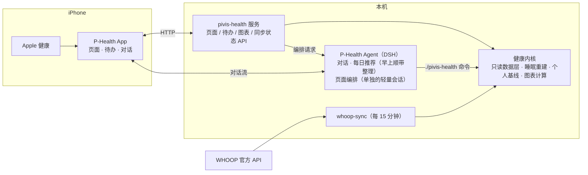

# P-Health · pivis-health

**一个会盯着你的健康数据、告诉你今天该做什么、并推着你去做的私人健康管家。**

P-Health 由三部分组成：

- **iOS App**（SwiftUI，黑白细线风格，在 [`ios/`](ios/)）：四个板块页、生成式待办、和 P-Health 对话、锁屏通知。
- **pivis-health**（Python，在仓库根目录）：健康内核和服务端。负责读数据、做确定性计算，提供页面、待办、图表和同步接口。
- **P-Health Agent**（跑在 DSH 上）：页面上写什么、主卡画什么图、待办怎么排，都由它根据真实数据生成。

App 只负责画出来，内核只负责把数算对；中间所有"说什么、做什么"都交给 Agent。


> 截图里的数据全部是编出来的演示数据（[`examples/make_demo.py`](examples/make_demo.py) 生成），不来自任何真人。

## 三条原则

1. **监测 → 建议 → 推动执行**。不只是展示指标：先找出眼下最该注意的一件事，给出今天能做的动作，到点提醒，做完记下来。
2. **Agent 原生**。页面结构固定，内容由 P-Health 生成：结论、主卡指标和画法、待办、习惯项目、对话里的卡片都是。
3. **越用越懂你**。你说一次"睡眠图看 14 晚""步数目标 1 万""拉伸用视频"，它就记成偏好，之后页面和对话都照做。

底线：**所有数字都来自内核计算，Agent 不自己编数**；**不做诊断**。常态范围按你自己近 30 天的数据算，不是医学标准。

## 功能

### 四个板块，每页只讲一件事

「现在 / 休息 / 运动 / 压力」，每页从上到下依次是：

- **一句结论**：判断加上该做什么。
- **主卡**：眼下最该注意的那个指标，配档位"需处理 / 留意 / 平稳"。档位点按严重程度有不同动效。
- **坚持习惯**：正在进行的长期项目，比如"睡前放松 · 第 8 天 / 21"。
- **接下来**：最多 3 件最急的待办，其余收在「另有 N 件」里。

### 主卡的图由 P-Health 选

内核提供 7 种画法：

| 画法 | 适合 | 看什么 |
|---|---|---|
| 折线 trend | HRV、呼吸、睡眠时长 | 走势、个人常态带、警戒线 |
| 半圆仪表 gauge | 恢复 | 分数落在哪一档 |
| 睡了 vs 需要 need | 睡眠 | 昨晚差多少，近 7 晚有几晚没睡够 |
| 叠起来 stack | 睡眠债 | 每晚欠的累计到多少 |
| 区间刻度 range | 静息心率 | 今天在自己常态的哪个位置 |
| 进度 progress | 步数 | 按此刻该走到哪 |
| 路线 route | 体重 | 朝目标的计划路线和实际 |

P-Health 只写"画哪项、用哪种、看几天"，数字由内核现算。你在对话里说"换一种看法"，它会先在对话里给你看页面同款的预览，你确认后再改，页面一两分钟后自动换上。

### 生成式待办和习惯

- 14 种待办形式：打勾、单选、数值、多字段日记、计数、计时、跟做、子清单、拍照、打分、提议、追问加文字、设备自动完成、确认加时间。每种点下去 1 秒内有反应，断网也先记在手机上，连上后自动补发。
- 长期项目（CBT-I 6 周、膝关节康复、减重路线……）每天自动生成当天的待办，还能只在一周的某几天出现。你改了模板，当天还没开始的那张就跟着变。
- 「此刻」页最多列 3 张最急的待办，其余收在「另有 N 件」里。
- 上床这类能自动识别的，设备记到就自动勾上。

### 跟练视频

- 你在对话里分享一个小红书或 B 站的动作示范视频，P-Health 先看懂它：有几个动作、各在哪一段、是不是单人完整示范。适合剪的话，它先给你一个方案，你确认后才出片。
- 出的片保持博主原速，按每个动作的秒数循环，配上报数，并署上博主的名字。验收不过就不交付。
- 练习类习惯就是「项目 + 一个跟练视频」：点卡片直接全屏播放，锁屏也能听到声音。
- 视频只给你自己用，不上传到任何公开网站。

### 通知和闹钟

- 服务器统一推送：P-Health 每回完一轮话、新问你一个问题、待办提前 N 分钟（默认 10，可以跟它说「提前 15 分钟提醒」）、到点、过点 15 分钟还没做，各推一次。
- 待办上写的是真正要做的时刻，提前量只由服务器给。
- 计时类（午睡、泡脚）：点「开始」就在手机上定一个系统闹钟，静音也响。卡上写了「几点叫你」就按那个时刻，没写就按开始时间加时长。服务器在同一时刻再推一条带声音的「时间到了」兜底。
- 没看的回复，在对应入口上显示小红点。

### 专业，而且越用越专业

- 睡眠（CBT-I）、训练（含膝关节和半月板的保守训练）、减重饮食（含 GLP-1 / GIP 类药物期间）、压力恢复、习惯养成，各有一份专业资料。内容有原理、能直接照着用的决策表、证据等级（A / B / C），并附指南和文献（[`agent/skills/*/references/`](agent/skills)）。
- 回答要具体：比如从上床时间往回推出几点停咖啡、几点洗完澡；每次练全身还是分部位；疼到几分该退一级。还要说出依据，弱证据直说证据弱。
- **你纠正一次，它就不再犯**：
  - 你纠正过的专业要点会记成「正确做法」，每个会话都看得到。
  - 同一件事被纠正第二次，它会提出把这条写进专业资料，由开发写进去。
- 每一块都有考题，放在封版测试里跑。

### 小组件和安装

- 主屏小组件：此刻主卡、今天还没做的待办（打勾类可以直接在小组件上勾）、上床时间、近 7 晚睡眠。
- 安装：TestFlight，或者开发版安装页（`install/`，ipa 不进仓库）。

### 和 P-Health 对话


- 回复里可以带卡片：提问、方案确认、改动回执、主卡同款的图、音视频跟练。
- 回复过程中会显示它正在做什么，比如"看今天的待办""记下你的偏好"。
- 输入框旁有拍照按钮，拍完直接发给它。饭、试纸这类需要拍照记录的待办，点"拍照"也是拍完直接进对话，它看图后记到那条待办上。

### 改动实时可见

P-Health 改页面或待办时，App 只框住正在变的那一块（上图右）：一道白光沿边框走，框里的内容变朦胧。改好后新内容自动换上，不用手动刷新；下拉也可以刷新。

### 数据

- **Apple 健康**：App 上报睡眠、步数、活动能量等，同一台手机重装 App 也只算一次。
- **WHOOP**：通过官方 API 每 15 分钟同步一次（夜里也拉），提供恢复、HRV、睡眠阶段、"需要睡多久"、静息心率、呼吸频率和训练；有新的恢复 / 睡眠 / 训练就马上重排页面。恢复、HRV、静息心率、呼吸频率算到醒来那天。
- **数据断了就如实说**："HRV 只到 10-31"。不拿旧数冒充新数，也不把缺数据当成正常或异常。WHOOP 断了的晚上，睡眠退回 Apple 健康的时长。

## 架构



- App 轮询 `/api/v3/status`：数据、页面或待办一变就自动刷新；哪一块正在被改，就框住哪一块。
- 页面编排时，内核把"证据"（各项数值、能画的图、项目和待办）交给 Agent；Agent 回一份页面 JSON，服务器校验后才发布。
- 偏好保存在 `pref.*` 记忆里，页面编排和对话共用同一份；你确认过的页面样子，发布前由代码核对。
- 你纠正过的专业要点（`correction.*`）、了解到的你（`profile.*` / `learn.*`）会渲染进 Agent 的规则文件，所有会话都看得到。
- 通知由服务器里的通知线程推送（APNs）；对话的设备密钥只给 App 和本机。

## 快速使用

```sh
python3 -m pivis_health.cli doctor             # 自检：库是否可读、各数据源最新到哪天
python3 -m pivis_health.cli viz                # 每项指标现在能不能画、在常态还是过了警戒线
python3 -m pivis_health.cli facts              # 页面编排用的证据
python3 -m pivis_health.cli page-v3 now        # 某个板块页的完整内容（now / sleep / sport / stress）
python3 -m pivis_health.cli todo-list          # 今天的待办
python3 -m pivis_health.cli whoop-status       # WHOOP 快照是否新鲜（不联网）
python3 -m pivis_health.cli serve              # 启动服务（默认 127.0.0.1:8943）
```

- 运行只需系统自带 Python 3.9+，不依赖第三方库。跑测试要装 pytest：`python3 -m venv .venv && .venv/bin/pip install pytest && .venv/bin/python -m pytest`。
- 本机路径、地址和凭据都写在 `config.local.json`，这个文件不进仓库。
- 想看演示环境：`python3 examples/make_demo.py <目录> .`，会生成一整套合成数据和配置。

接入 Agent 的方式见 [docs/DSH-INTEGRATION.md](docs/DSH-INTEGRATION.md)，Agent 的规则见 [agent/AGENTS-v3.md](agent/AGENTS-v3.md)。

## 目录

```text
pivis-health/
├── pivis_health/      # 内核与服务
│   ├── readonly.py    #   只读数据层（同一样本跨重装只算一次）
│   ├── sleep.py       #   睡眠重建（双计 / 平行轨防线）
│   ├── baselines.py   #   个人基线
│   ├── whoop.py / whoop_sync.py   # WHOOP 快照解析 / 官方 API 同步
│   ├── viz.py         #   主卡图表计算（7 种画法）
│   ├── todos.py       #   生成式待办与习惯项目
│   ├── v3.py          #   页面证据、编排、校验，同步状态
│   ├── prefs.py / agent_context.py  # 偏好与共享记忆
│   ├── dsh_chat.py    #   和 DSH 上 P-Health 的对话桥
│   └── web.py / cli.py
├── agent/             # P-Health 的规则（AGENTS-v3.md）和技能（skills/，专业资料在各自的 references/）
├── ios/               # iOS App 和小组件（SwiftUI）
├── examples/          # 合成演示数据生成器
├── install/           # 开发版安装页（ipa 不进仓库）
├── scripts/           # 定时编排脚本
├── tests/             # 回归测试（合成数据）
└── docs/              # 架构、隐私、接入说明、截图
```

## 隐私

- 不上传真实健康记录、餐照或试纸照片、聊天记录、设备标识、私人路径、地址或凭据。
- 截图和示例只用明确标注的合成数据，不用"真实记录改名、改日期"得到的样本。
- 详见 [docs/PRIVACY.md](docs/PRIVACY.md)。

**非医疗器械，不用于诊断、治疗、用药或紧急监测，不能替代医生。** 工程上的异常筛选不等于疾病诊断，消费级设备的记录也不等于临床测量。

## 许可证

本仓库自有内容采用 [MIT](LICENSE)。第三方代码、依赖、模型及平台服务遵循各自许可证。
