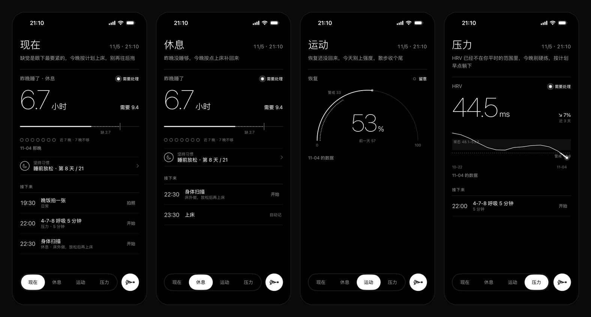
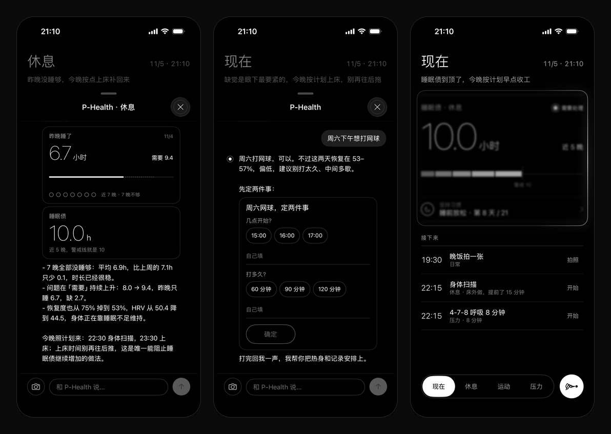

# P-Health iOS

P-Health 的 iOS 客户端（SwiftUI）。服务端、健康内核和 Agent 规则在同一个仓库的根目录（[`../`](../)）。

黑底、白色细线、尽量少的元素。页面上写什么、主卡画什么图、待办和对话卡片长什么样，都由 P-Health Agent 生成；App 只负责把它画好、把交互做顺。



> 截图全部是合成演示数据（服务端仓库的 `examples/make_demo.py`），不是真人数据。

## 功能

- **四个板块**（现在 / 休息 / 运动 / 压力）：从上到下依次是一句结论、主卡（眼下最该注意的指标 + 档位）、坚持习惯、接下来的待办。
- **主卡图表**：折线、半圆仪表、睡了 vs 需要、睡眠债叠加、区间刻度、步数进度、体重路线，共 7 种，用哪种由 P-Health 定。档位点有动效：需处理时最强，留意时缓慢，平稳不动；开了"减弱动态效果"时全部静止。
- **生成式待办**：打勾、填写、拍照、跟做（分步计时、音频或视频）、提议。到点系统提醒，错过再提醒一次，午睡可以用系统闹钟。
- **对话**：
  - 回复逐句流式显示，同时显示它在做什么（"看今天的待办""记下你的偏好"）。
  - 卡片有：提问、方案确认、改动回执、主卡同款的图（`viz`）、音视频。
  - 拍照按钮：拍完直接发给 P-Health。压缩和上传在后台做，界面不卡。
  - 只要一张照片的待办（如"晚饭拍一张"），点"拍照"直接开相机，拍完进对话，记到那条待办上。
- **改动实时可见**：
  - App 轮询服务器 `/api/v3/status`，页面、待办、偏好或健康数据一变就自动刷新。
  - P-Health 正在改哪块就框住哪块（整张主卡，或某几条待办）：一道白光沿边框走，外圈柔光呼吸，框里内容朦胧。改好后新内容从朦胧变清楚，不用手动刷新。
- **健康数据上报**：读 Apple 健康（睡眠分段、步数、活动能量、心率类、体重），按天聚合后上报。设备 id 存在钥匙串里，重装 App 也是同一台设备。



## 本地配置

两个本地文件不进 git，从示例复制：

```bash
cp LocalConfig.swift.example PivisHealth/LocalConfig.swift   # 服务器地址（局域网 / Tailnet）
cp Signing.xcconfig.example Signing.xcconfig                 # 你的 Apple 开发者团队 ID
```

打开 `PivisHealth.xcodeproj`，构建 `PivisHealth` scheme。

## 出包

- `export-ipa.sh`：开发签名的 IPA，装到已登记的设备。
- `export-ipa-tf.sh`：App Store 签名的 IPA，用于 TestFlight。
- 项目放在 iCloud 同步的「文稿」里时，签名会被同步加上的扩展属性挡住（报错 "resource fork, Finder information…"）。这时把产物放到同步区外面：

```bash
PIVIS_BUILD_DIR=/tmp/phealth-build ./export-ipa.sh
```

模拟器构建同理，加 `-derivedDataPath` 指到同步区外面。

## 测试用启动参数

| 参数 | 作用 |
|---|---|
| `-pivisProfile sim` | 连模拟回放服务（8944 端口）而不是正式服务（8943） |
| `-uiTestDisableDeviceData` | 不读健康数据、不上报、不弹权限 |
| `-initialPage 0…3` | 打开时停在第几个板块 |
| `-openChat main / 休息 / 运动 / 压力` | 打开时直接进对话 |
| `-chatSend <文字>` | 进对话后自动发一句 |
| `-chatPhoto <图片路径> [-chatPhotoTodo <id> <标题> <字段>]` | 只在模拟回放下生效：走和拍照一样的发送流程 |

## 代码结构

| 文件 | 内容 |
|---|---|
| `V3Shell.swift` | 根布局：四个板块、滑块胶囊底栏、对话入口、全局打开对话 |
| `V3Page.swift` | 板块页：结论、主卡、坚持习惯、接下来 |
| `RiskViz.swift` | 7 种主卡图、档位点动效、对话里的 `viz` 预览 |
| `UpdateGlow.swift` | 框住正在改的块：白色流光 + 朦胧；收束线记号 |
| `PageSync.swift` | 和服务器同步：什么时候刷新、哪块在改 |
| `TodoCard.swift`、`GenControls.swift`、`ExecView.swift` | 生成式待办、输入控件、跟做页 |
| `NativeChatView.swift`、`DshAPI.swift`、`DshStreamClient.swift` | 对话、流式回复、动作提示、生成式卡片 |
| `ChatPhoto.swift` | 拍照、后台压缩、对话里的照片 |
| `Reminders.swift` | 到点提醒、闹钟 |
| `V3API.swift`、`V3Theme.swift` | 页面模型、设计 token（颜色、字号、细线） |
| `App.swift` | 启动、推送、健康数据读取与上报、钥匙串 |
